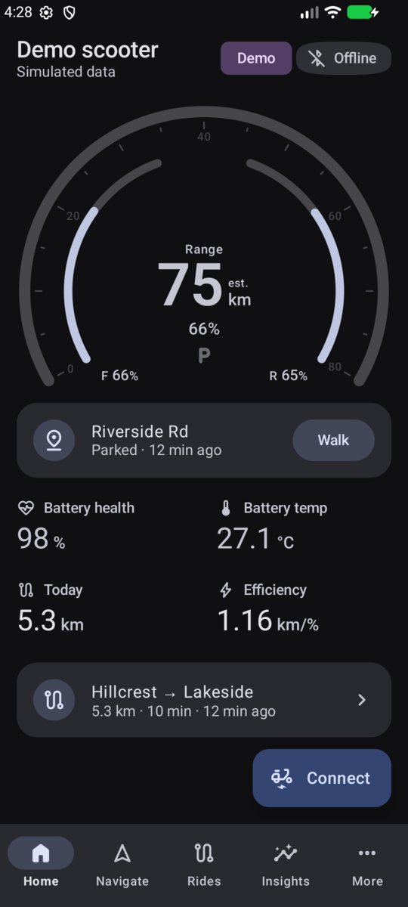
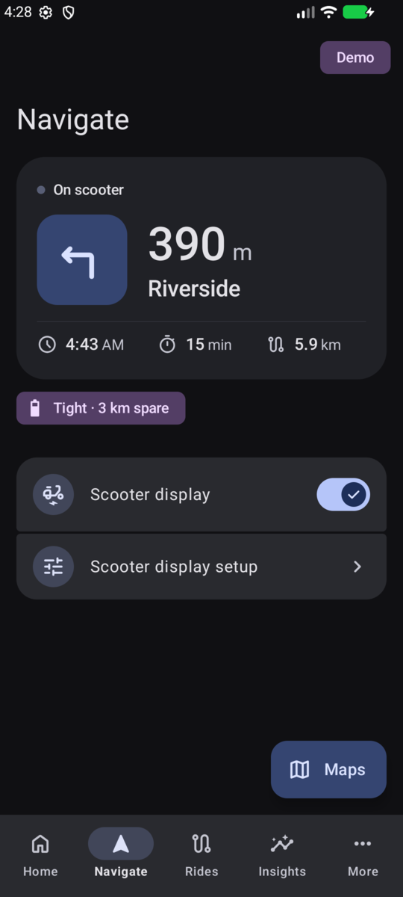
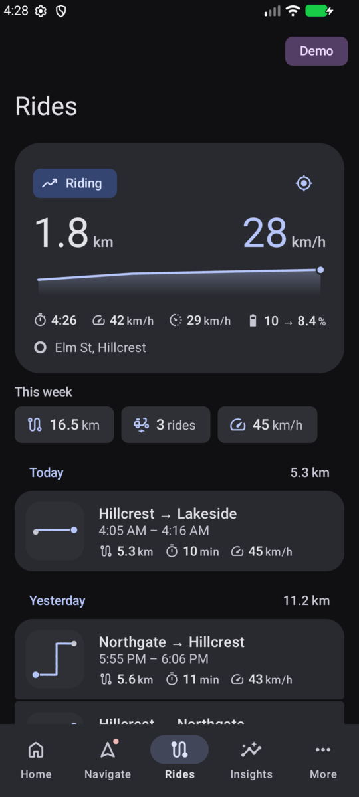
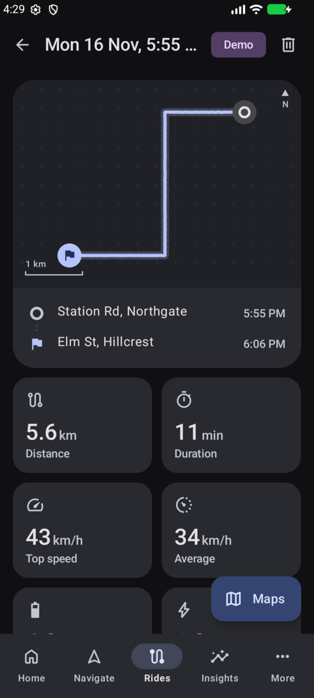
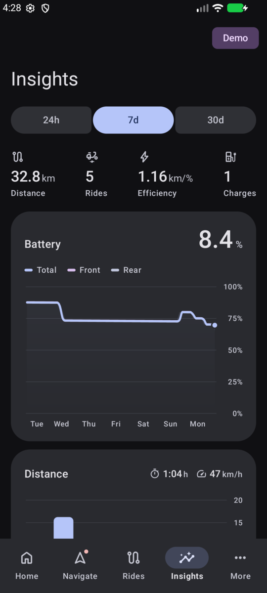
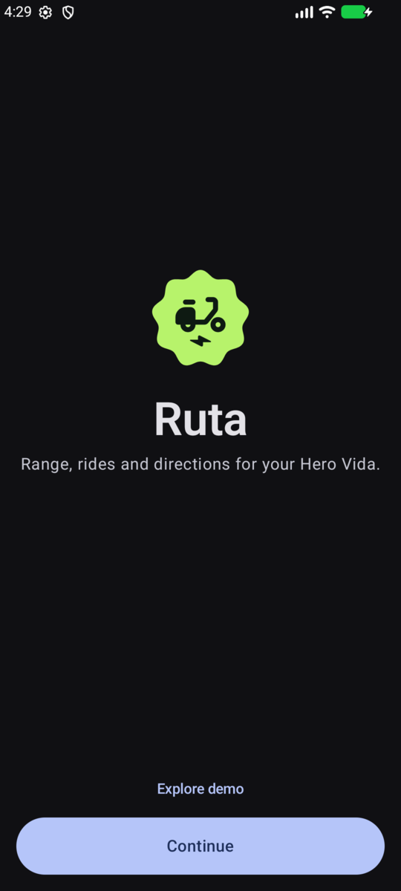

# Chetooth

**Ruta, for the Bajaj Chetak.** A free Android companion that shows your Chetak's live battery % and
range over Bluetooth, records every ride with your phone's GPS, charts battery and charging history,
checks if you have enough range for a Google Maps route, and remembers where you parked. No account,
no cloud, no ads.

Chetooth is a fork of [Ruta](https://github.com/CODESURGEN/ruta) (Apache-2.0) by CODESURGEN, which does
the same for Hero Vida scooters. Everything on the phone side is Ruta's; the scooter link gained a
**Chetak mode**.

## Install

Download **[chetooth.apk](https://github.com/vsshegur/Chetooth/releases/latest/download/chetooth.apk)**
on your phone and open it (allow installs from your browser when Android asks). Every push to `main`
builds a new one with GitHub Actions; it installs over the previous version. Android 11+ with Bluetooth LE.

## First run

1. Pair the Chetak with your phone in Android Bluetooth settings, as the Chetak app asks you to.
   (Most Chetaks pair without a PIN.)
2. Open Chetooth, allow Nearby devices and Location, and pick your Chetak (it is listed first, as
   "paired"). Close the official Chetak app first: the scooter may accept only one app at a time.
3. **Teach the battery %** (More › Chetak setup): type the % on the dashboard and tap Save. Ride or
   charge until it changes and save again. Chetooth finds the matching number in the scooter's data
   and uses it from then on. Range (km) works the same way and is optional.

## Why there is a "teach" step

Ruta reads the Vida from a documented layout (`docs/PROTOCOL.md`). Bajaj has not published how the
Chetak sends its data, and nobody has decoded it publicly, so Chetooth learns it on your scooter.
In Chetak mode it subscribes to every value the scooter offers and reads every readable one. It
**never writes to the scooter**, so it cannot change anything on it. If no match turns up, share the
data from More › Chetak setup › Share data (or More › Diagnostics) so the format can be decoded by hand.

Hero-only features (directions, music and calls on the scooter's display, handlebar buttons) are
hidden: they need the Vida's display protocol. A Hero Vida still connects exactly as in Ruta.

## Build

GitHub Actions (`.github/workflows/build.yml`) runs `bash test.sh` and `bash build.sh` (kotlinc, d8,
aapt2, apksigner; no Gradle) and publishes the APK as a release. See Ruta's notes below for local builds.

## Disclaimer

Not affiliated with or supported by Bajaj Auto, Chetak Technology, Hero MotoCorp or Vida. Use at your
own risk.

---

# Ruta

**A free, open-source Android companion for Hero Vida electric scooters.** Ruta shows live battery
and range, records every ride, charts battery health, and puts Google Maps directions, music and
calls on the scooter's own display. Everything stays on your phone: no account, no cloud, no ads.

<p align="center">
  
  
  
  
  
  
</p>

<p align="center">
  <a href="https://github.com/CODESURGEN/ruta/releases/latest"><b>Download the latest APK</b></a> ·
  Android 11+ · about 2 MB · Apache-2.0
</p>

## Features

- 🛵 **Live cluster.** Speed, front and rear pack charge, range, drive / standby / charging.
- 🔋 **Battery you can read.** Health, temperature, efficiency (km per 1 %), "Full in" while charging.
- 🧭 **Directions on the scooter.** Turn arrow, distance, road name and arrival from Google Maps.
- ↪️ **Back-to-back turns.** "Then left" instead of the road name when Maps announces a second turn right after.
- ⛽ **Range check.** "12 km spare", "Tight" or "Short by 4 km" for the route you are on.
- 🎵 **Music.** Song, artist and volume on the display; handlebar buttons play, skip and change volume.
- 📞 **Calls.** Caller name on the display; answer or reject from the handlebar; missed calls and messages.
- 💬 **Show who messaged.** Optional (off by default): the sender's name on the music line when nothing is playing.
- 🗺️ **Ride receipts.** Rides recorded with the phone's GPS: route map, start and end, distance, speeds, battery used.
- 📈 **Insights.** 24 h / 7 d / 30 d charts for charge, range, temperature, health, pack balance and charging.
- 📍 **Find my scooter.** Remembers where you parked; one tap for walking directions.
- 🔔 **Alerts.** Charged to 80 / 90 / 100 %, charging stopped, not enough range for the route.
- 🔐 **Saved scooters.** Several scooters, each with its own PIN, stored encrypted on the phone.
- 🎨 **Material 3 Expressive.** Dynamic colour, big glanceable numbers, dark theme.
- 🧪 **Demo mode.** Try every screen without a scooter.

## Works with

- Hero Vida scooters with the Bluetooth telematics unit (TCU). Tested on a **VX2**.
- Android 11 or newer with Bluetooth LE. Google Maps for directions.

Other Vida models may work; please open an issue with what you see.

## Install

1. Open the [latest release](https://github.com/CODESURGEN/ruta/releases/latest) on your phone and
   download `ruta-1.0.2.apk`.
2. Open the file. When Android asks, allow your browser (or file manager) to
   **install unknown apps**.
3. **Play Protect.** Ruta is not on Google Play and reads notifications (for Maps directions and
   music), so Play Protect may warn about it. If it offers **More details › Install anyway**, choose
   that. In India (and some other regions) Play Protect's enhanced fraud protection can instead
   **block** the install with no "Install anyway" option. Then:
   1. Open the **Play Store** › your profile picture › **Play Protect** › **Settings** (gear icon).
   2. Turn off **Scan apps with Play Protect**.
   3. Open the APK again and install it.
   4. Turn **Scan apps with Play Protect** back on.

   Developers can also install over USB with `adb install -r ruta-1.0.2.apk`.

Official APKs are signed with the Ruta release key, certificate SHA-256:
`CE:53:91:68:9D:03:E0:54:31:AE:4E:B1:A7:E7:82:7D:B1:2C:D3:CD:2C:3A:63:A5:11:76:7E:06:63:0E:BE:D3`
(check with `apksigner verify --print-certs ruta-1.0.2.apk`).

Updates install over the top and keep your history. An APK signed with a different key (for
example your own build) cannot update it.

## First run

1. Close the official Vida app (it holds the scooter's Bluetooth link).
2. Open Ruta › **Continue** › allow **Nearby devices** (Location and Notifications are optional).
3. Pick your scooter from the list (names start with `HMC_`). Not listed? Use **Enter address**.
4. Enter the scooter's **Bluetooth PIN**. You find it in the official Vida app: home screen ›
   **USE PIN**, while Bluetooth is disconnected. Already paired in Android? No PIN needed.
5. Ruta connects. From now on it reconnects by itself.

**Notification access greyed out?** On Android 13 and newer, apps installed from a browser or file
manager are "restricted": the **Ruta directions & music** switch under Notification access cannot
be turned on until you open **Settings › Apps › Ruta › ⋮ (top right) › Allow restricted settings**.
Then turn on Notification access again (Ruta's Navigate tab takes you there).

## Directions on the scooter display

The display shows directions only while its Navigation widget is on:

1. Long-press the toggle button on the handlebar.
2. **Menu › Display**.
3. **Widgets › Navigation**.
4. Turn it on.

Then start navigation in Google Maps (or from Ruta's **Navigate** tab). Ruta needs **Notification
access** to read the Maps directions; it asks for it on the Navigate tab (greyed out: see
**Notification access greyed out?** under First run).

## Demo mode

No scooter nearby? Tap **Explore demo** on the Welcome screen, or **More › Diagnostics › Demo mode**.
A **Demo** chip in the top bar switches scenario or exits:

`parked` · `riding` · `navigating` · `charging` · `call` · `music`

The demo never touches Bluetooth, posts no notifications and uses its own history, which is
deleted when you exit. Your rides and scooters are left alone.

## Privacy

- 📱 All data (rides, battery history, saved scooters) stays in Ruta's private storage on your phone.
- 🙅 No account, no analytics, no ads, no cloud.
- 🌐 The only network use is Android's Geocoder, to turn ride start, end and parking points into
  place names.
- 🔑 Scooter PINs are encrypted with an Android Keystore key. PINs, the IMEI and the VIN are never logged.
- 📤 Your data leaves the phone only when you export a CSV or share a diagnostics log yourself.
  Logs contain the scooter's Bluetooth name and address; remove them before posting a log publicly.

Permissions: Nearby devices (scooter link), Location (rides, parking, distance countdown),
Notifications (alerts and the ride notification), Notification access (Maps directions and music),
Phone and contacts (caller name, missed calls, answering from the handlebar). Everything except
Nearby devices is optional and can be changed under **More › Permissions**.

## Build from source

No Gradle: `build.sh` runs kotlinc › d8 › aapt2 › zipalign › apksigner.

Requirements: JDK 17+, Kotlin (`kotlinc` on `PATH`), Android SDK with `build-tools;36.0.0` and
`platforms;android-36`, Python 3.

```sh
bash test.sh                  # host tests on the JVM
bash build.sh --compile-only  # compile only, no signing key needed
bash build.sh                 # signed APK in dist/, checked by tests/check_apk.py
bash build.sh --unsigned      # same APK without a signature (what F-Droid builds), no key needed
```

A full build needs a signing key from `RUTA_KEYSTORE`, `RUTA_KEY_ALIAS`, `RUTA_KEYSTORE_PASS`
(and `RUTA_KEY_PASS` if different), set in the environment or a git-ignored `local.env`. Forks
set `RUTA_SIGNER_SHA256` to their own certificate's SHA-256. Details in
[CONTRIBUTING.md](CONTRIBUTING.md).

## Docs

- [docs/PROTOCOL.md](docs/PROTOCOL.md) — the scooter's Bluetooth protocol, as far as Ruta uses it
- [docs/DESIGN.md](docs/DESIGN.md) — design principles and screen spec
- [docs/UIKIT.md](docs/UIKIT.md) — the in-app UI kit (framework views, Material 3 Expressive)

## Contributing

Bug reports, scooter logs (with identifiers removed) and pull requests are welcome. Start with
[CONTRIBUTING.md](CONTRIBUTING.md).

## Support the project

If Ruta helps you, you can show some love via UPI: `repalamanideep54-1@okhdfcbank`

## Licence

[Apache License 2.0](LICENSE). Third-party notices are in [NOTICE](NOTICE) and in the app
(**More › About › Licences**).

## Disclaimer

Ruta is an independent project, **not affiliated with, endorsed by or supported by Hero MotoCorp
or Vida**. "Hero" and "Vida" are used only to say which scooters Ruta works with. Ruta uses only
the scooter's unencrypted Bluetooth channels and never touches its encrypted command service, but
the scooter maker does not support it: use it at your own risk. Keep your eyes on the road; set
up navigation and music before you ride.
